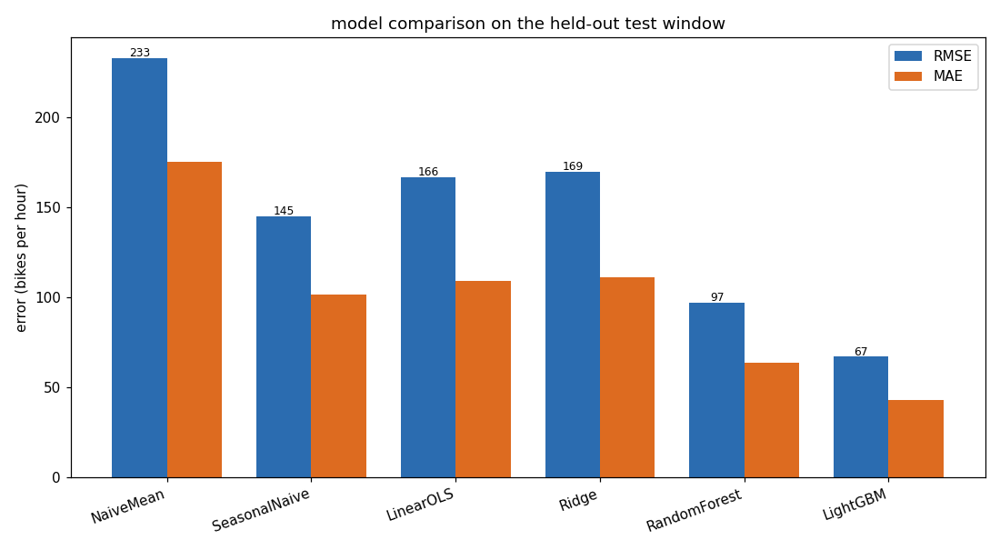
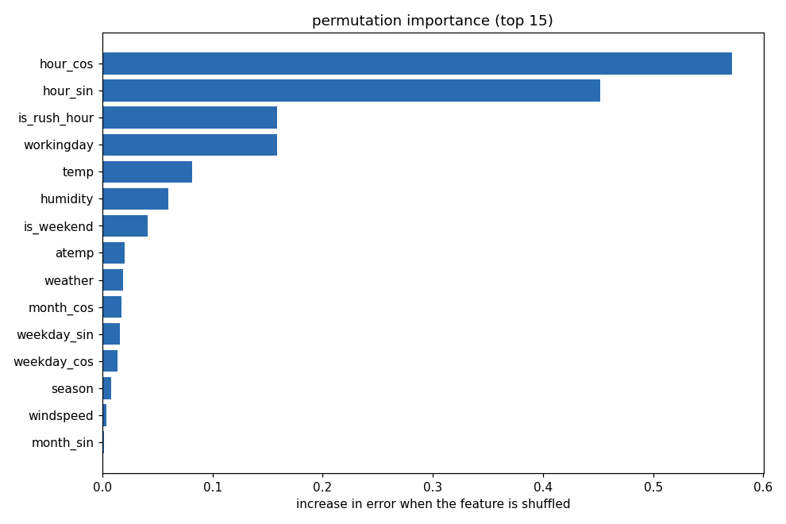
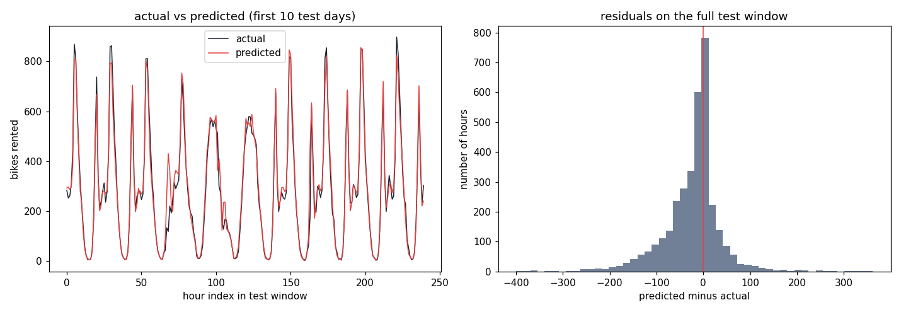
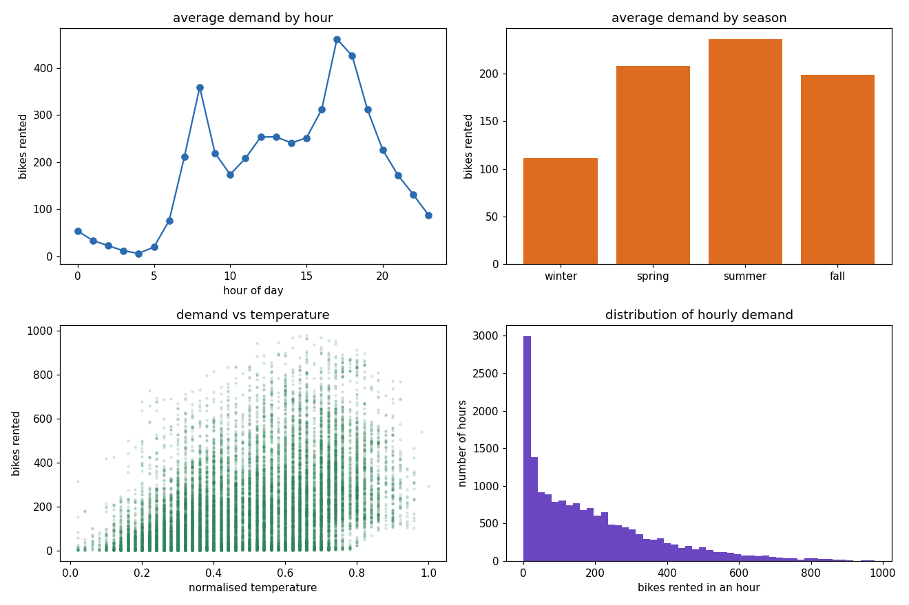

# PedalCast


Hourly demand forecasting for a city bike-share system. Given the hour, the calendar, and the weather, it predicts how many bikes riders will want in the next hour so an operations team can move bikes to where the demand is going to be instead of chasing it after the fact.

The model is trained on two years of Capital Bikeshare records from Washington DC. On the held-out final months it lands at an R2 of 0.91 and a mean absolute error of 43 bikes per hour, against a system that averages 189 rentals an hour.

## Why I built it

Bike-share operators lose money in two directions. Empty docks at a busy station during the morning commute are lost rentals. Full docks with a van sitting nearby is wasted rebalancing labor. Both come down to the same question: how many bikes will this hour actually need? Most teams answer it with a rule of thumb, usually the average for that hour of the day. I wanted to see how far a proper model could push past that rule of thumb, and whether the gain was big enough to matter operationally.

The short answer is yes. The hour-of-day average (what I call the seasonal baseline below) already explains a lot, but it still misses by about 102 bikes an hour on average. The gradient boosting model cuts that to 43.

## Results

Measured on the last 3,476 hours of the record (the chronological 20% test window, so the model only ever sees the past when predicting the future).

| model | RMSE | MAE | R2 | RMSLE |
|---|---|---|---|---|
| naive mean | 232.6 | 175.0 | -0.11 | 1.433 |
| seasonal naive (hour x working day) | 144.9 | 101.6 | 0.568 | 0.593 |
| linear (OLS) | 166.4 | 108.8 | 0.430 | 0.780 |
| ridge | 169.4 | 110.9 | 0.409 | 0.781 |
| random forest | 97.1 | 63.4 | 0.806 | 0.440 |
| LightGBM | 66.8 | 43.0 | 0.908 | 0.366 |

LightGBM wins clearly. The linear models are worth keeping in the table because they are honest about the ceiling of a purely additive view of this problem: demand is driven by interactions (a warm hour matters far more at 8am than at 3am), and the trees pick those up while the linear fit cannot. I kept the seasonal baseline in too, because beating a number the operations team already trusts is the only comparison that means anything to them.



### What drives the prediction

Permutation importance on the test window, strongest first: hour of day (the two cyclical encodings and the rush-hour flag together dominate), whether it is a working day, temperature, humidity, and the weekend flag. None of that is surprising, which is a good sign. The model is leaning on the same things a dispatcher would.



### How the forecast tracks reality

The left panel is the first ten days of the test window, predicted against actual. The model tracks the twin commute peaks on weekdays and flattens correctly on weekends. Residuals are roughly centered on zero with the spread you would expect to widen on the highest-demand hours.



### The data itself



Two things jump out during exploration and both end up mattering to the model. Demand is sharply bimodal across the day (7-9am and 5-7pm), and it scales almost linearly with temperature until it gets hot enough to put people off. Hourly counts are right-skewed, which is why every model here is trained on `log1p(count)` and inverted back, keeping predictions non-negative and stopping the busiest hours from dominating the loss.

### Business impact

I framed the payoff against the seasonal baseline, since that is the realistic status quo. The model reduces mean absolute error from 101.6 to 43.0 bikes per hour, a 58% cut. Over the test window that is about 203,000 bikes of cumulative forecast error avoided.

Turning that into money needs one assumption, which I am stating openly rather than burying: I value each bike of avoided error at $1.50, treating it as either a captured rental or a saved rebalancing move. At that rate, annualised, the improvement over the baseline is worth roughly $770,000 a year on a system this size. Change the assumption and the number moves linearly; the operational fact under it (a 58% error reduction) does not.

## How it works

```
data/hour.csv
      |
      v
 load_hourly (polars)      read, validate, rename, drop casual+registered (target leak)
      |
      v
 build_feature_frame       cyclical hour/month/weekday, rush-hour and weekend flags
      |
      v
 chronological_split       first 80% train, last 20% test, never shuffled
      |
      v
 ColumnTransformer         one-hot season/weather/year, pass numeric through
      |
      v
 TransformedTargetRegressor(log1p / expm1)
      |                    Ridge | RandomForest | LightGBM   (+ OLS and naive baselines)
      v
 evaluate on test -> metrics.json, charts, best model saved to models/
```

Every preprocessing step lives inside the fitted pipeline, so there is no separate transform to keep in sync between training and scoring, and nothing leaks from test into train. The single-row scoring path used by the app runs the exact same `build_feature_frame`, which is what the app tests check.

## Install

```bash
git clone https://github.com/ranjithguggilla/pedalcast.git
cd pedalcast
pip install -e .
```

Python 3.10 or newer.

## Usage

Train, evaluate, and write the model plus metrics and charts:

```bash
python -m pedalcast.train
```

That reads `data/hour.csv`, prints the comparison table, saves the four charts to `assets/`, writes `outputs/metrics.json`, and drops the best pipeline at `models/pedalcast_model.joblib`.

Score interactively:

```bash
streamlit run src/pedalcast/app.py
```

Pick an hour, a season, and the weather, and it returns the predicted rentals for that hour with a plain-language reason for the number.

Score in code:

```python
from pedalcast.app_logic import load_bundle, predict_demand

bundle = load_bundle()
predict_demand(bundle, {
    "season": 3, "year": 1, "month": 7, "hour": 8, "weekday": 2,
    "workingday": 1, "weather": 1, "temp": 0.62, "humidity": 0.55, "windspeed": 0.15,
})
# -> 694
```

## Configuration

The knobs live in `src/pedalcast/config.py`: the test fraction (0.2), the random seed, and the `$1.50` per-bike value used only for the business-impact figure. Model hyperparameters are in `build_models` in `model.py`.

## Output structure

```
assets/
  eda_overview.png
  model_comparison.png
  predictions.png
  feature_importance.png
outputs/
  metrics.json           every model's scores, best model, top features, impact
  ols_coefficients.csv   linear coefficients with p-values, for interpretability
models/
  pedalcast_model.joblib  best pipeline plus its feature list
```

## Project structure

```
src/pedalcast/
  config.py       paths and constants
  data.py         load and validate the raw CSV (polars)
  features.py     leak-free feature engineering
  model.py        preprocessor, baselines, models, metrics
  train.py        the end-to-end run
  plots.py        chart generation
  app_logic.py    scoring logic, unit tested without a server
  app.py          streamlit front end
tests/            pytest suite
data/             hour.csv and day.csv from UCI
```

## Technical notes

- Target is modeled as `log1p(count)` via `TransformedTargetRegressor` and inverted on output, then clipped at zero.
- The split is by time, not random. Random splitting on this data leaks near-duplicate neighbouring hours into the test set and flatters every score.
- `casual` and `registered` are dropped at load time because they sum exactly to the target.
- The linear baseline is a real statsmodels OLS fit (train R2 0.70), and its coefficients with p-values are written to `outputs/ols_coefficients.csv` so the linear story is auditable.
- Importance is permutation-based on the held-out window, so it reflects predictive value rather than in-sample split counts.

## Testing

```bash
pytest -q
ruff check .
```

Fourteen tests cover the loader (schema, leakage columns, row count), the feature engineering (cyclical bounds, commute flags), the modeling layer (chronological split is disjoint and ordered, metric correctness, non-negative predictions), and the scoring path (rush hour outscores the small hours, the explainer fires). CI runs the same lint and tests on every push, then trains the model on the main branch and uploads it as an artifact.

## Dataset

Bike Sharing Dataset, UCI Machine Learning Repository. Fanaee-T, Hadi, and Gama, Joao, "Event labeling combining ensemble detectors and background knowledge", Progress in Artificial Intelligence (2013). Source: https://archive.ics.uci.edu/dataset/275/bike+sharing+dataset. Two years of hourly counts from Capital Bikeshare with matching weather and calendar fields.

## License

MIT. See [LICENSE](LICENSE).
